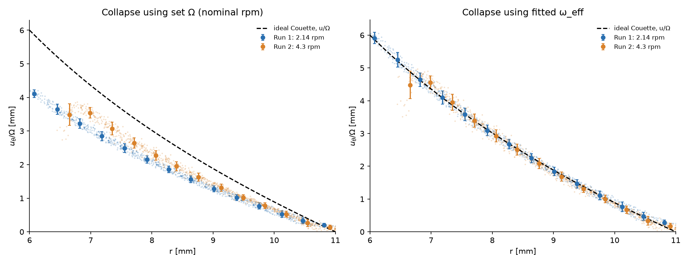

# EN309 G6: PIV results

Couette cell: inner cylinder R1 = 6 mm rotating, outer bore R2 = 11 mm fixed, 88:12 glycerine:water, 10 µm hollow seeding,
100 fps, 6.18 µm/px (161.9 px per grid square, assumed 1 mm). All frames used (step 1, dt = 3 frames), 4 time blocks per run.

## Effective angular speed

| | Run 1 (2.14 rpm) | Run 2 (4.3 rpm) |
|---|---|---|
| Set Ω | 0.2241 rad/s | 0.4503 rad/s |
| ω_eff by block | 0.146, 0.160, 0.153, 0.134 | 0.321, 0.320, 0.337, 0.320 |
| **ω_eff, block mean ± SD** | **0.148 ± 0.011 rad/s** | **0.324 ± 0.008 rad/s** |
| ω_eff / Ω_set | 0.66 | 0.72 |
| Drift over run (linear fit) | −8.6 % | +1.0 % |
| ω_eff, averaged field (all frames) | 0.156 rad/s | 0.350 rad/s |
| ω_eff, shared radial shift | 0.151 rad/s | 0.353 rad/s |
| Pairs used | 3988 | 2488 |

- Run 2 shows no drift. Run 1 drops in its last block, but the trend rests on four points and is within the block scatter.
- The measured speed is 28–34 % below the set rpm in both runs. The shortfall differs between runs, so it is not a fixed scale error.
  Candidate causes: actual motor speed, end effects from the leaks, laser sheet height, bias against the velocity gradient, refraction affecting the scale.

## Fit to the exact Couette solution

u_θ = A r + B/r, with A = −ωR1²/(R2²−R1²), B = ωR1²R2²/(R2²−R1²). Free parameters: ω_eff and a radial shift (the walls are outside the field of view).

| Averaged field | Run 1 | Run 2 |
|---|---|---|
| Radial shift | −1.37 mm | −1.46 mm (shared: −1.45 mm) |
| Couette R² / RMSE | 0.996 / 0.017 mm/s | 0.979 / 0.074 mm/s |
| Linear R² / RMSE (u = a + b r) | 0.981 / 0.035 mm/s | 0.967 / 0.093 mm/s |
| Inner-wall speed, set → fitted | 1.34 → 0.93 mm/s | 2.70 → 2.10 mm/s |
| Vectors used | 936 | 927 |

- The gap (5 mm) is not small against R1 (6 mm), so the true profile is curved. The straight line fits worse than the Couette form (1.3–2× the RMSE), though R² stays above 0.96.
- Single-block fits are noisier (R² 0.90–0.99) than the averaged field.

## Collapse of u_θ/Ω

| Scaling | rms spread between runs (r = 7–11 mm) |
|---|---|
| u_θ / Ω_set (nominal rpm) | 16 % |
| u_θ / ω_eff (fitted) | 3 % |

With the fitted ω_eff the two rotation rates fall onto the ideal Couette curve; with the nominal Ω they sit apart because
ω_eff/Ω_set differs between runs (0.70 and 0.78 in the averaged-field fit). The innermost run-2 bin (r ≈ 6.6 mm) is noisy.

## Viscosity

Not computed. The outer cylinder is fixed, so there is no torque reading, and the Newtonian Couette velocity profile does not depend on μ.
The 126 mPa·s reference (Cheng 2008, 24 °C) assumes 88 wt% glycerine; the mix was described as "88 parts", so by volume it could be about 90 wt%,
which would raise the reference.

## Open items

- Confirm the grid square is 1 mm and whether the scale image was taken through the filled cell.
- Confirm the true motor speed (the cause of ω_eff < Ω_set).
- Confirm whether 88:12 was by mass or volume.

Files: `analysis/G6_EN309_results.xlsx` (workbook), `analysis/out/*.json` (numbers), `analysis/HANDOFF.md` (setup and method).
